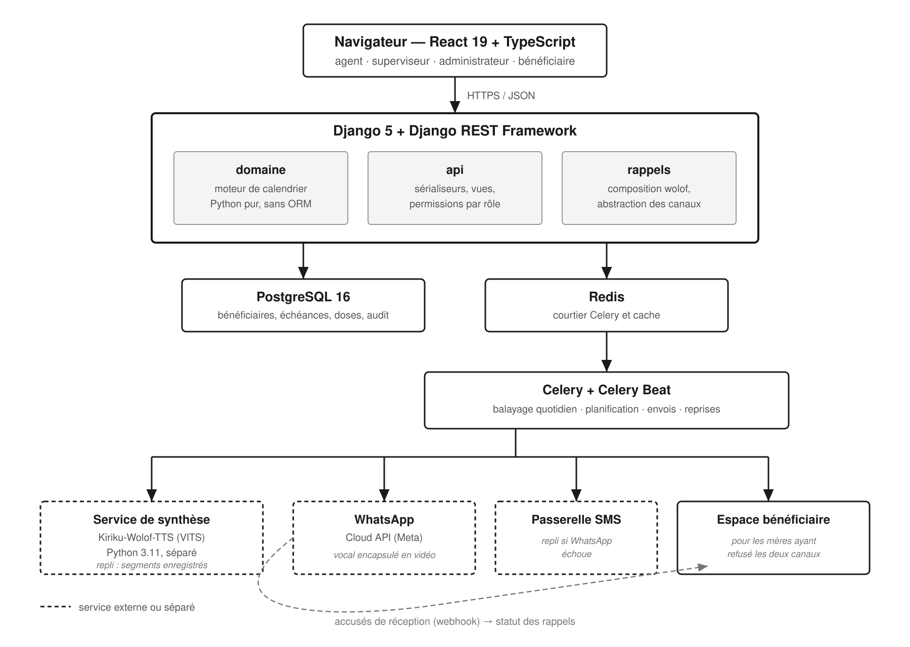

# SUVAC — Kaay Ñakku

Plateforme de suivi de la vaccination pré et post natale, avec rappels
vocaux en wolof envoyés par WhatsApp.

Projet final du module Développement Web Backend — École Polytechnique de Thiès.
Encadrant : Professeur Michel Seck.

## Ce que fait l'application

Un agent de santé enregistre une mère et ses enfants. Le système calcule
leur calendrier vaccinal à partir du schéma du PEV sénégalais, affiche
chaque matin la file des bénéficiaires attendus, et envoie aux mères un
rappel vocal en wolof avant chaque échéance.

Le superviseur suit la couverture de son poste, gère son personnel et
consulte le journal des rappels émis. La mère, si l'agent lui ouvre un
accès, consulte le carnet de ses enfants et ses messages.

## Architecture



Le navigateur parle à Django, qui tient le moteur de calendrier, l'API et
l'abstraction des canaux. PostgreSQL conserve les données, Redis sert de
courtier à Celery, qui exécute le balayage quotidien et les envois.

Les messages vocaux passent par un service de synthèse séparé : le modèle
wolof exige des versions de bibliothèques incompatibles avec le backend.
WhatsApp est le canal principal, le SMS le repli, et l'application elle-même
sert les mères qui ont refusé les deux.

## Pile technique

Django 5 et Django REST Framework, PostgreSQL 16, Celery et Redis côté
serveur. React 19, TypeScript et Vite côté client. Docker Compose pour
l'environnement local.

---

# Installation

Trois niveaux, du plus simple au plus complet. Le premier suffit pour voir
fonctionner l'application entière.

## 1. L'essentiel — dix minutes

L'application tourne, les rappels sont composés en wolof et consultables
dans le journal. Aucun message n'est envoyé : le canal de simulation les
journalise.

### Ce qu'il faut

Docker et Docker Compose, Python 3.13, Node 22.

### Les services

```bash
git clone https://github.com/Fallou236/suvac.git
cd suvac
docker compose up -d db
```

Si un PostgreSQL tourne déjà sur le port 5432, arrêtez-le ou changez le port
dans `docker-compose.yml`.

### Le backend

```bash
cd backend
python -m venv .venv
source .venv/bin/activate          # Windows : .venv\Scripts\Activate.ps1
pip install -r requirements.txt
cp .env.example .env
```

Ouvrez `backend/.env` et renseignez la clé secrète :

```bash
python -c "import secrets; print(secrets.token_urlsafe(64))"
```

Laissez les variables `WHATSAPP_*` et `SYNTHESE_*` vides : sans elles,
l'application bascule sur la simulation.

```bash
python manage.py migrate
python manage.py charger_schema_pev
python manage.py charger_descriptions
python manage.py charger_donnees_demo --vider
python manage.py runserver
```

### Le frontend

Dans un second terminal :

```bash
cd frontend
npm install
npm run dev
```

L'application est sur `http://localhost:5173`.

### Les comptes

Mot de passe commun : `suvac-demo-2026`

| Identifiant | Rôle | À observer |
|---|---|---|
| `awa.ndiaye` | Agent, Ndondol | File du jour, saisie d'une dose |
| `fatou.gueye` | Superviseur, Ndondol | Pilotage, journal des rappels, personnel |
| `omar.diallo` | Superviseur, Ngaparou | Les mêmes écrans, d'autres chiffres : le cloisonnement |
| `admin.suvac` | Administrateur | Postes, journal d'audit |
| `rokhaya.ba` | Bénéficiaire | L'espace de la mère, en wolof |
| `yacine.seck` | Bénéficiaire | Deux enfants suivis |

Toutes les données sont fictives (ENF-24).

### Déclencher un balayage

```bash
python manage.py balayer
```

Les rappels sont composés, journalisés, et consultables dans l'écran
« Journal des rappels » avec `fatou.gueye`.

---

## 2. Les messages vocaux

Ajoute la voix wolof aux rappels. Le service de synthèse tourne dans son
propre conteneur : le modèle exige Python 3.11 et PyTorch, incompatibles
avec le backend.

### Le modèle

Il pèse 952 Mo, n'est pas inclus dans l'image, et son dépôt est protégé.
Il faut un compte Hugging Face, accepter les conditions sur
`huggingface.co/AIHubSN/Kiriku-Wolof-TTS`, et créer un jeton de type *Read*
dans Settings puis Access Tokens.

```bash
HF_TOKEN=hf_votre_jeton docker compose run --rm synthese-modele
```

Le modèle est stocké dans un volume Docker et ne sera téléchargé qu'une
fois. Comptez une à deux minutes.

### Le service

```bash
docker compose up -d synthese
docker compose logs -f synthese
```

Le modèle met une vingtaine de secondes à charger au démarrage. Vérifiez :

```bash
curl http://localhost:8800/sante
```

### L'activer côté backend

Dans `backend/.env` :

```
SYNTHESE_URL=http://127.0.0.1:8800
```

Au prochain balayage, les messages seront prononcés. Comptez cinq à vingt
secondes par message. Les fichiers produits sont dans
`backend/media/synthese/` et les vidéos dans `backend/media/videos/`.

Si le service est arrêté, le backend bascule sur l'assemblage de segments
pré-enregistrés : les rappels partent quand même.

---

## 3. L'envoi réel par WhatsApp

Demande un compte Meta Business et un numéro de test. Gratuit, mais une
trentaine de minutes de configuration.

### Le compte

Créez un compte sur `business.facebook.com`, puis une application de type
Business sur `developers.facebook.com` avec le produit WhatsApp.

Meta fournit un numéro de test et un jeton. Déclarez les numéros
destinataires dans la section « À » — cinq au maximum, chacun validant un
code reçu sur WhatsApp.

### Le modèle de message

Dans le Gestionnaire WhatsApp, créez un modèle :

- Nom : `rappel_vaccinal`
- Catégorie : Utilitaire
- Langue : Français
- En-tête : Vidéo
- Corps : `Rappel de vaccination pour {{1}}. Écoutez le message.`
- Pied de page : `Kaay Ñakku — Poste de santé`

L'approbation prend de quelques minutes à quelques heures.

### La configuration

Dans `backend/.env` :

```
WHATSAPP_NUMERO_ID=l-identifiant-du-numero-de-test
WHATSAPP_COMPTE_ID=l-identifiant-du-compte-business
WHATSAPP_JETON=le-jeton
WHATSAPP_VERSION_API=v25.0
WHATSAPP_MODELE_RAPPEL=rappel_vaccinal
```

Le jeton temporaire expire en vingt-quatre heures. Pour un jeton permanent,
créez un utilisateur système dans les paramètres d'entreprise, affectez-lui
l'application et le compte WhatsApp, puis générez un jeton avec les
autorisations `whatsapp_business_messaging` et `whatsapp_business_management`.

### Essayer

Attribuez votre numéro à une mère :

```bash
python manage.py charger_donnees_demo --vider --telephone "+221771234567"
python manage.py balayer
```

Ou directement :

```bash
python manage.py essayer_whatsapp 221771234567
```

Le numéro doit avoir été déclaré au préalable dans la liste des
destinataires autorisés du compte de test.

---

# Vérifier

```bash
cd backend && pytest -q
cd frontend && npm run verifier
```

286 tests côté serveur à 87 % de couverture, 168 côté client à 85 %.

# Documentation

- `docs/rapport/rapport.pdf` — le rapport de projet
- `docs/cahier-des-charges.pdf` — périmètre, exigences, architecture
- `docs/adr/` — décisions d'architecture et leurs justifications
- `docs/sprints/` — planifications et rétrospectives
- `docs/libelles-wolof.md` — formulations validées par un locuteur natif
- `docs/identite-visuelle/` — palette, logo, jetons de conception
- `services/synthese/LISEZMOI.md` — le service de synthèse vocale

# Dépannage

**La base refuse la connexion.** Le conteneur ne tourne pas :
`docker compose ps`.

**Le port 6379 ou 5432 est déjà pris.** Un Redis ou un PostgreSQL tourne
déjà sur la machine. Lancez seulement ce qui manque :
`docker compose up -d db synthese`.

**Le téléchargement du modèle renvoie 401.** Les conditions du dépôt n'ont
pas été acceptées avec le compte du jeton, ou le jeton n'a pas la portée
nécessaire. Un jeton à portée fine doit inclure l'accès en lecture aux
dépôts protégés.

**Sous Linux, `docker` demande sudo.** Ajoutez votre utilisateur au groupe :
`sudo usermod -aG docker $USER`, puis reconnectez-vous. Avec `sudo`, pensez
à placer les variables après : `sudo HF_TOKEN=... docker compose ...`.

**Les rappels ne partent pas.** Vérifiez le consentement de la mère : aucun
rappel n'est émis sans consentement actif (EF-47). Vérifiez aussi que son
numéro figure dans la liste autorisée chez Meta.

**Un message est accepté par Meta mais n'arrive pas.** Le numéro n'est
probablement pas déclaré, ou sa validation n'a pas été faite. Cherchez la
conversation sous le numéro de test américain, pas sous un nom.
